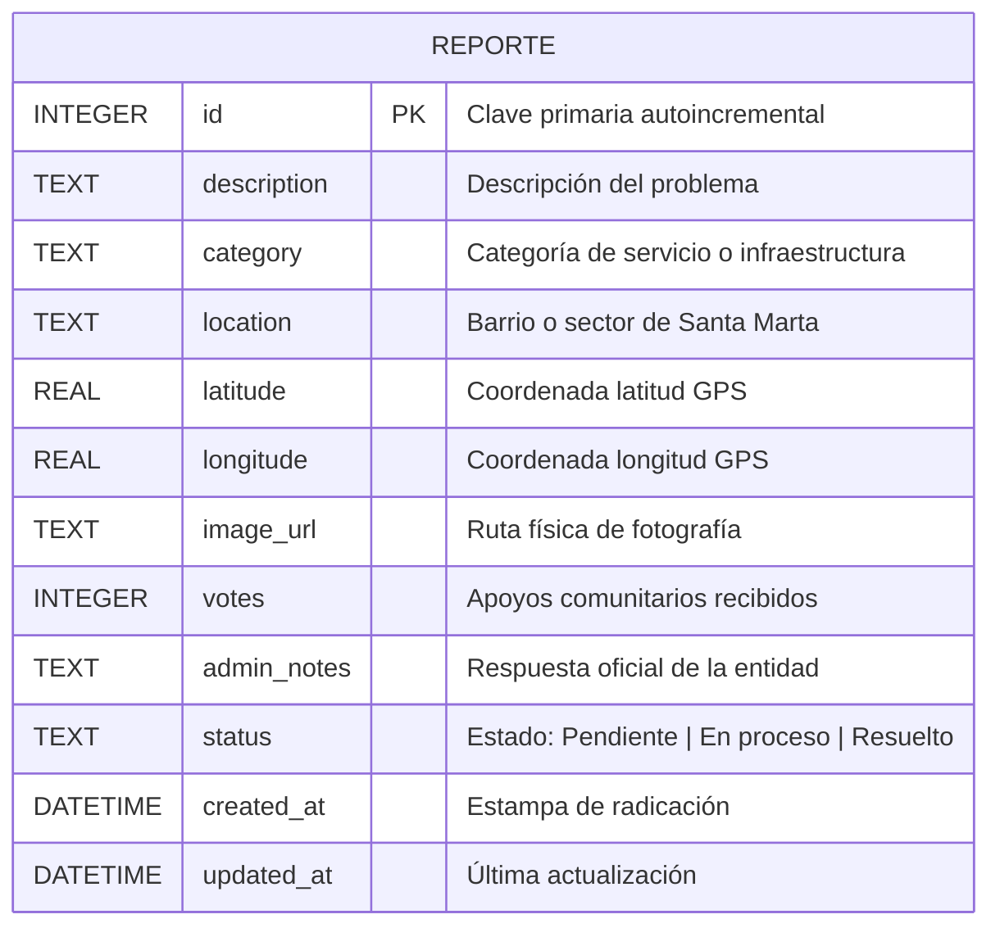
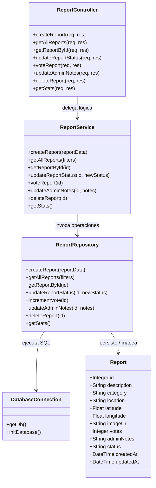
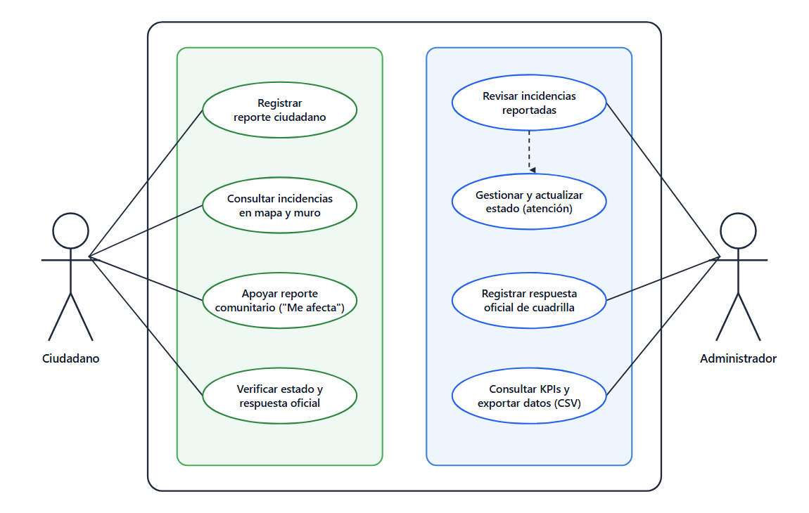
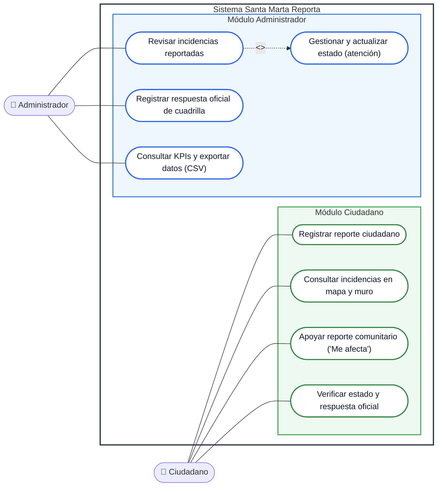
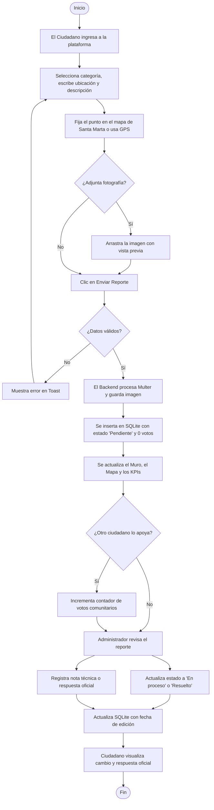
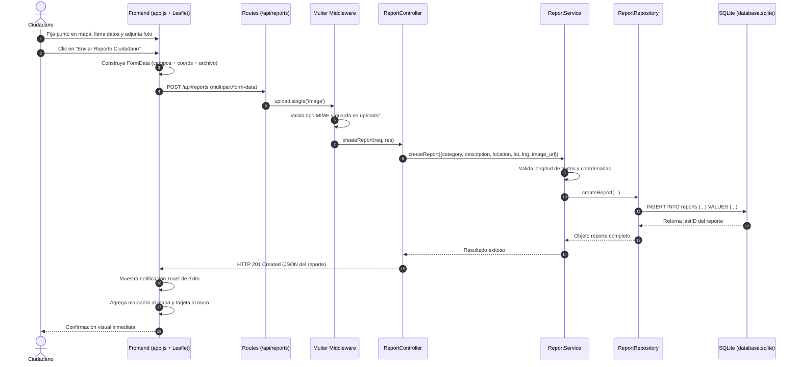
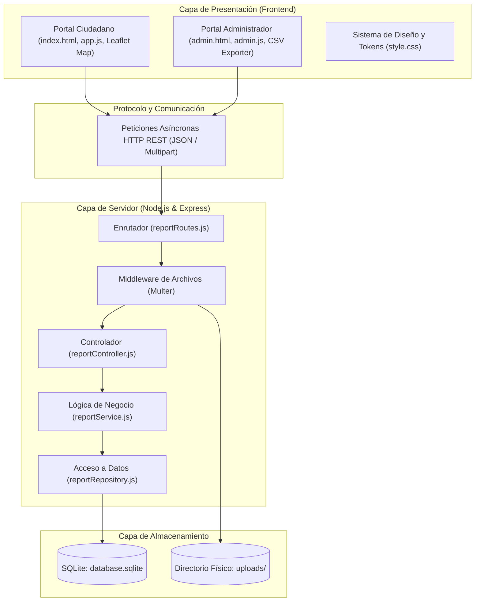

# Documento de Proyecto de Software (Segundo Seguimiento)
## Sistema Web de Reporte Ciudadano: "Santa Marta Reporta"

---

## 1. Contexto

La ciudad de Santa Marta, Distrito Turístico, Cultural e Histórico, es uno de los centros urbanos y turísticos más relevantes de la región Caribe colombiana. Su dinamismo demográfico y la constante afluencia de visitantes demandan un mantenimiento continuo de los servicios públicos, la malla vial, la recolección de residuos y la conservación de los espacios de uso común.

Sin embargo, como ocurre en múltiples urbes en crecimiento, la administración distrital y las empresas de servicios públicos afrontan el reto de identificar y priorizar con prontitud las afectaciones que surgen a diario en los barrios (fugas de agua potable, vertimiento de aguas servidas, acumulación de basuras en esquinas y playas, fallas en el alumbrado público y deterioro de vías vehiculares y peatonales). 

Actualmente, muchas de estas situaciones dependen de quejas dispersas en redes sociales o trámites presenciales que carecen de trazabilidad, lo que dilata los tiempos de respuesta y genera descontento en la comunidad.

---

## 2. Planteamiento del Problema

### 2.1 Descripción de la Problemática
Los ciudadanos de Santa Marta no disponen de un canal digital unificado, ágil y de acceso público que les permita notificar de manera georreferenciada sobre un mapa interactivo y con soporte fotográfico las anomalías que afectan su entorno cotidiano. 

Por otro lado, el personal técnico o administrativo carece de un panel centralizado y ligero donde pueda clasificar las incidencias recibidas, verificar las evidencias fotográficas, consultar métricas en tiempo real, emitir respuestas oficiales y actualizar el estado de atención (Pendiente, En proceso, Resuelto), limitando la transparencia y la participación ciudadana en el cuidado del distrito.

### 2.2 Formulación del Problema
> *¿De qué manera un sistema web basado en arquitectura Cliente-Servidor, patrón MVC y geolocalización interactiva puede optimizar el registro, la visualización, la priorización comunitaria y el seguimiento del estado de las problemáticas urbanas en la ciudad de Santa Marta?*

---

## 3. Objetivos del Proyecto

### 3.1 Objetivo General
Desarrollar e implementar un aplicativo web robusto bajo arquitectura Cliente-Servidor y patrón MVC multicapa que permita la captura, geolocalización en mapa interactivo, persistencia relacional, administración y seguimiento transparente de reportes e incidencias urbanas en Santa Marta, operable en red local (LAN) bajo servidor Ubuntu.

### 3.2 Objetivos Específicos
1. **Levantar y documentar** los requerimientos funcionales y no funcionales que rigen el ciclo de vida de un reporte ciudadano georreferenciado.
2. **Modelar la base de datos relacional** y el dominio del sistema mediante esquemas SQL con campos de geolocalización, apoyos ciudadanos y trazabilidad de respuestas oficiales.
3. **Construir el backend** mediante Node.js, Express y SQLite, garantizando una separación limpia de responsabilidades (Rutas, Controladores, Servicios y Repositorios).
4. **Desarrollar una interfaz de usuario interactiva y adaptable** con mapas dinámicos (Leaflet.js), estadísticas en vivo, sistema de apoyo comunitario ("Me afecta") y tablero de gestión administrativa con exportación a CSV.
5. **Configurar y desplegar el sistema** en un servidor Ubuntu Server accesible por dispositivos conectados a una misma red de área local (LAN).

---

## 4. Requerimientos del Sistema

### 4.1 Requerimientos Funcionales (RF)

| Campo | Detalle |
|---|---|
| **Identificación del requerimiento:** | RF01 |
| **Nombre del Requerimiento:** | Registro de reporte ciudadano |
| **Características:** | El ciudadano puede radicar un reporte seleccionando la categoría de la anomalía, describiendo el problema, especificando el barrio y marcando el punto exacto en el mapa. |
| **Descripción del requerimiento:** | El sistema permitirá capturar y almacenar los datos de la incidencia urbana (categoría, descripción, dirección/barrio y coordenadas geográficas) asignándole automáticamente fecha y estado inicial "Pendiente". |
| **Prioridad del requerimiento:** | ALTA |

<br>

| Campo | Detalle |
|---|---|
| **Identificación del requerimiento:** | RF02 |
| **Nombre del Requerimiento:** | Geolocalización interactiva en mapa |
| **Características:** | El ciudadano puede visualizar un mapa interactivo de Santa Marta, arrastrar el marcador de ubicación o hacer clic sobre la zona exacta donde ocurrió el incidente. |
| **Descripción del requerimiento:** | El sistema integrará Leaflet.js y OpenStreetMap para registrar de forma automática la latitud y longitud precisas de cada incidente urbano radicado. |
| **Prioridad del requerimiento:** | ALTA |

<br>

| Campo | Detalle |
|---|---|
| **Identificación del requerimiento:** | RF03 |
| **Nombre del Requerimiento:** | Subida y previsualización de evidencias fotográficas |
| **Características:** | El ciudadano puede seleccionar una imagen desde su dispositivo móvil o PC, ver una previsualización inmediata y enviarla junto al reporte. |
| **Descripción del requerimiento:** | El sistema permitirá cargar imágenes de evidencia (JPG, PNG, WEBP de hasta 5MB), almacenándolas en el servidor y vinculando la ruta segura al registro de la base de datos. |
| **Prioridad del requerimiento:** | ALTA |

<br>

| Campo | Detalle |
|---|---|
| **Identificación del requerimiento:** | RF04 |
| **Nombre del Requerimiento:** | Visualización en muro comunitario y mapa general |
| **Características:** | Los usuarios pueden alternar entre una vista de tarjetas fotográficas y un mapa global interactivo con pines de colores según el estado de la incidencia. |
| **Descripción del requerimiento:** | El sistema presentará públicamente todos los reportes comunitarios con sus datos esenciales, fotos, badges de estado y ventanas informativas (popups) en el mapa. |
| **Prioridad del requerimiento:** | ALTA |

<br>

| Campo | Detalle |
|---|---|
| **Identificación del requerimiento:** | RF05 |
| **Nombre del Requerimiento:** | Apoyo comunitario ("Me afecta") |
| **Características:** | Cualquier ciudadano puede respaldar una problemática existente con un clic para indicar que también padece la misma situación en su sector. |
| **Descripción del requerimiento:** | El sistema permitirá incrementar el contador de votos o apoyos de una incidencia en tiempo real, facilitando la priorización visual de las quejas más críticas. |
| **Prioridad del requerimiento:** | MEDIA |

<br>

| Campo | Detalle |
|---|---|
| **Identificación del requerimiento:** | RF06 |
| **Nombre del Requerimiento:** | Búsqueda y filtrado reactivo |
| **Características:** | El usuario puede filtrar los reportes en pantalla por categoría (Vías, Basuras, Alumbrado, etc.), por estado (Pendiente, En proceso, Resuelto) o por palabra clave. |
| **Descripción del requerimiento:** | El sistema filtrará instantáneamente los resultados tanto en el muro como en los marcadores del mapa sin necesidad de recargar la página completa. |
| **Prioridad del requerimiento:** | ALTA |

<br>

| Campo | Detalle |
|---|---|
| **Identificación del requerimiento:** | RF07 |
| **Nombre del Requerimiento:** | Panel administrativo tabular de gestión |
| **Características:** | El administrador cuenta con una vista dedicada en tabla con listado completo de incidencias, filtros rápidos y acceso a herramientas de gestión. |
| **Descripción del requerimiento:** | El sistema proveerá una interfaz administrativa centralizada que lista los reportes con sus fotografías, votos, coordenadas y botones de acción rápida. |
| **Prioridad del requerimiento:** | ALTA |

<br>

| Campo | Detalle |
|---|---|
| **Identificación del requerimiento:** | RF08 |
| **Nombre del Requerimiento:** | Actualización del estado de atención |
| **Características:** | El administrador puede cambiar el ciclo de vida de un reporte entre los estados: "Pendiente", "En proceso" y "Resuelto". |
| **Descripción del requerimiento:** | El sistema actualizará el estado en la base de datos y sincronizará la vista pública de inmediato para mantener informada a la ciudadanía. |
| **Prioridad del requerimiento:** | ALTA |

<br>

| Campo | Detalle |
|---|---|
| **Identificación del requerimiento:** | RF09 |
| **Nombre del Requerimiento:** | Registro de respuesta oficial de la entidad |
| **Características:** | El administrador puede redactar un mensaje o nota técnica oficial explicando la acción tomada o la cuadrilla asignada al reporte. |
| **Descripción del requerimiento:** | El sistema guardará la respuesta institucional y la mostrará públicamente en la tarjeta del reporte y en la ventana del mapa para consulta de los ciudadanos. |
| **Prioridad del requerimiento:** | MEDIA |

<br>

| Campo | Detalle |
|---|---|
| **Identificación del requerimiento:** | RF10 |
| **Nombre del Requerimiento:** | Estadísticas y métricas en tiempo real (KPIs) |
| **Características:** | Los usuarios y directivos pueden consultar tarjetas con indicadores cuantitativos del sistema. |
| **Descripción del requerimiento:** | El sistema calculará y mostrará el total de reportes registrados, reportes pendientes, en atención, solucionados y cantidad acumulada de apoyos ciudadanos. |
| **Prioridad del requerimiento:** | MEDIA |

<br>

| Campo | Detalle |
|---|---|
| **Identificación del requerimiento:** | RF11 |
| **Nombre del Requerimiento:** | Exportación de reportes a formato CSV |
| **Características:** | El administrador puede descargar un archivo plano con todos los registros para análisis externo o presentación de informes. |
| **Descripción del requerimiento:** | El sistema generará y descargará un archivo CSV con codificación UTF-8 que incluye identificador, fecha, categoría, ubicación, coordenadas, estado, votos y respuestas. |
| **Prioridad del requerimiento:** | MEDIA |

---

### 4.2 Requerimientos No Funcionales (RNF)

| Campo | Detalle |
|---|---|
| **Identificación del requerimiento:** | RNF01 |
| **Nombre del Requerimiento:** | Facilidad de uso (Usabilidad) |
| **Características:** | Las opciones de la aplicación deben presentarse de forma clara, visual e intuitiva tanto para el ciudadano como para el administrador. |
| **Descripción del requerimiento:** | El sistema ofrecerá una navegación limpia, botones con iconos descriptivos, retroalimentación mediante notificaciones flotantes (toasts) y formularios guiados. |
| **Prioridad del requerimiento:** | ALTA |

<br>

| Campo | Detalle |
|---|---|
| **Identificación del requerimiento:** | RNF02 |
| **Nombre del Requerimiento:** | Seguridad |
| **Características:** | El sistema debe validar los datos entrantes y proteger el servidor contra inyecciones y cargas de archivos maliciosos. |
| **Descripción del requerimiento:** | El sistema validará tipos MIME permitidos para imágenes (JPG, PNG, WEBP), limitará el tamaño a 5MB y empleará consultas preparadas (parameterized queries) para evitar inyecciones SQL. |
| **Prioridad del requerimiento:** | ALTA |

<br>

| Campo | Detalle |
|---|---|
| **Identificación del requerimiento:** | RNF03 |
| **Nombre del Requerimiento:** | Privacidad |
| **Características:** | Los datos de geolocalización e imágenes aportados por los ciudadanos deben utilizarse exclusivamente para la atención de la incidencia. |
| **Descripción del requerimiento:** | El sistema no exigirá datos sensibles obligatorios para la radicación y resguardará los identificadores internos de cada reporte. |
| **Prioridad del requerimiento:** | ALTA |

<br>

| Campo | Detalle |
|---|---|
| **Identificación del requerimiento:** | RNF04 |
| **Nombre del Requerimiento:** | Rendimiento |
| **Características:** | Las operaciones de consulta, radicación de incidencias y carga cartográfica deben ejecutarse de manera ágil sin demoras perceptibles. |
| **Descripción del requerimiento:** | El sistema responderá a las peticiones de la API REST en un tiempo promedio inferior a 300 ms en red local, con índices SQL optimizados en las consultas recurrentes. |
| **Prioridad del requerimiento:** | MEDIA |

<br>

| Campo | Detalle |
|---|---|
| **Identificación del requerimiento:** | RNF05 |
| **Nombre del Requerimiento:** | Disponibilidad |
| **Características:** | El aplicativo debe mantenerse operativo de forma continua para que cualquier usuario de la red local pueda acceder en todo momento. |
| **Descripción del requerimiento:** | El servicio se ejecutará sobre Node.js escuchando peticiones en segundo plano en la red LAN local, garantizando alta tolerancia a fallos básicos. |
| **Prioridad del requerimiento:** | ALTA |

<br>

| Campo | Detalle |
|---|---|
| **Identificación del requerimiento:** | RNF06 |
| **Nombre del Requerimiento:** | Integridad de datos |
| **Características:** | La información registrada en los reportes debe conservarse completa, inalterable y consistente a lo largo del tiempo. |
| **Descripción del requerimiento:** | El motor SQLite garantizará transaccionalidad ACID y restricciones `CHECK` en los estados permitidos (`Pendiente`, `En proceso`, `Resuelto`) junto con marcas temporales automáticas. |
| **Prioridad del requerimiento:** | ALTA |

<br>

| Campo | Detalle |
|---|---|
| **Identificación del requerimiento:** | RNF07 |
| **Nombre del Requerimiento:** | Compatibilidad y adaptabilidad |
| **Características:** | La aplicación debe funcionar correctamente en navegadores web modernos (Chrome, Firefox, Edge, Safari) y adaptarse a PCs, tabletas y smartphones. |
| **Descripción del requerimiento:** | El sistema implementará un diseño responsivo (CSS Grid / Flexbox) y escuchará peticiones en `0.0.0.0:3000` para ser compatible con cualquier dispositivo en la red LAN. |
| **Prioridad del requerimiento:** | MEDIA |

<br>

| Campo | Detalle |
|---|---|
| **Identificación del requerimiento:** | RNF08 |
| **Nombre del Requerimiento:** | Mantenibilidad |
| **Características:** | La estructura del código fuente debe permitir revisiones, correcciones y extensiones modulares sin romper funcionalidades existentes. |
| **Descripción del requerimiento:** | El proyecto implementa una arquitectura en capas basada en el patrón MVC (Rutas, Controladores, Servicios, Repositorios y Configuración de Base de Datos). |
| **Prioridad del requerimiento:** | MEDIA |

<br>

| Campo | Detalle |
|---|---|
| **Identificación del requerimiento:** | RNF09 |
| **Nombre del Requerimiento:** | Confiabilidad |
| **Características:** | Las funciones principales del sistema deben comportarse de forma estable durante las operaciones simultáneas de los usuarios. |
| **Descripción del requerimiento:** | El sistema gestionará los errores de forma controlada enviando respuestas JSON explicativas al cliente y manteniendo la persistencia física en el archivo de base de datos SQLite. |
| **Prioridad del requerimiento:** | ALTA |

---

## 5. Modelo de Datos

### 5.1 Script DDL (SQL)
Implementado mediante la tabla `reports` en **SQLite**:

```sql
-- Creación de la tabla de reportes con georreferenciación y seguimiento
CREATE TABLE IF NOT EXISTS reports (
    id INTEGER PRIMARY KEY AUTOINCREMENT,
    description TEXT NOT NULL,
    category TEXT NOT NULL,
    location TEXT NOT NULL,
    latitude REAL DEFAULT 11.24079,
    longitude REAL DEFAULT -74.19904,
    image_url TEXT,
    votes INTEGER DEFAULT 0,
    admin_notes TEXT,
    status TEXT DEFAULT 'Pendiente' CHECK(status IN ('Pendiente', 'En proceso', 'Resuelto')),
    created_at DATETIME DEFAULT CURRENT_TIMESTAMP,
    updated_at DATETIME DEFAULT CURRENT_TIMESTAMP
);

-- Índices de consulta rápida
CREATE INDEX IF NOT EXISTS idx_reports_created_at ON reports(created_at DESC);
CREATE INDEX IF NOT EXISTS idx_reports_category ON reports(category);
CREATE INDEX IF NOT EXISTS idx_reports_status ON reports(status);
```

### 5.2 Diccionario de Datos

| Campo | Tipo | Nulo | Por Defecto | Descripción |
|---|---|:---:|:---:|---|
| `id` | `INTEGER` | NO | `AUTOINCREMENT` | Identificador único y clave primaria del reporte. |
| `description` | `TEXT` | NO | - | Explicación detallada de la anomalía urbana. |
| `category` | `TEXT` | NO | - | Clasificación del problema (Vías, Basuras, Alumbrado, etc.). |
| `location` | `TEXT` | NO | - | Barrio o dirección de referencia en Santa Marta. |
| `latitude` | `REAL` | NO | `11.24079` | Coordenada de latitud en Santa Marta. |
| `longitude` | `REAL` | NO | `-74.19904` | Coordenada de longitud en Santa Marta. |
| `image_url` | `TEXT` | SÍ | `NULL` | Ruta pública del archivo fotográfico en el servidor. |
| `votes` | `INTEGER` | NO | `0` | Cantidad de apoyos ciudadanos ("Me afecta"). |
| `admin_notes` | `TEXT` | SÍ | `NULL` | Respuesta oficial o nota técnica emitida por el administrador. |
| `status` | `TEXT` | NO | `'Pendiente'` | Estado del ciclo de vida ('Pendiente', 'En proceso', 'Resuelto'). |
| `created_at` | `DATETIME` | NO | `CURRENT_TIMESTAMP` | Fecha y hora de creación de la incidencia. |
| `updated_at` | `DATETIME` | NO | `CURRENT_TIMESTAMP` | Fecha y hora de la última modificación de estado o respuesta. |

### 5.3 Modelo Entidad - Relación (Mermaid)



### 5.4 Diagrama de Clases del Dominio y Capas



---

## 6. Diagramas de Diseño del Sistema (UML)

### 6.1 Diagrama de Casos de Uso





### 6.2 Diagrama de Actividades (Ciclo Completo de una Incidencia)



### 6.3 Diagrama de Secuencia (Creación con Geolocalización y Foto)



---

## 7. Arquitectura del Sistema (MVC Multicapa & Cliente-Servidor)



---

## 8. Conclusiones y Estado del Proyecto
1. **Robustez y Usabilidad:** La incorporación de geolocalización interactiva con Leaflet.js, apoyos ciudadanos, filtros en tiempo real y respuestas oficiales eleva el sistema de un prototipo básico a una plataforma integral de gobierno abierto.
2. **Arquitectura Limpia:** La separación MVC garantiza que las consultas de filtrado, las migraciones dinámicas y las validaciones de negocio residan en sus capas correspondientes sin acoplamiento.
3. **Persistencia y Portabilidad:** La base de datos relacional SQLite con almacenamiento físico local de imágenes asegura un despliegue veloz y autónomo en cualquier máquina con Node.js y en servidores Ubuntu bajo red LAN.
