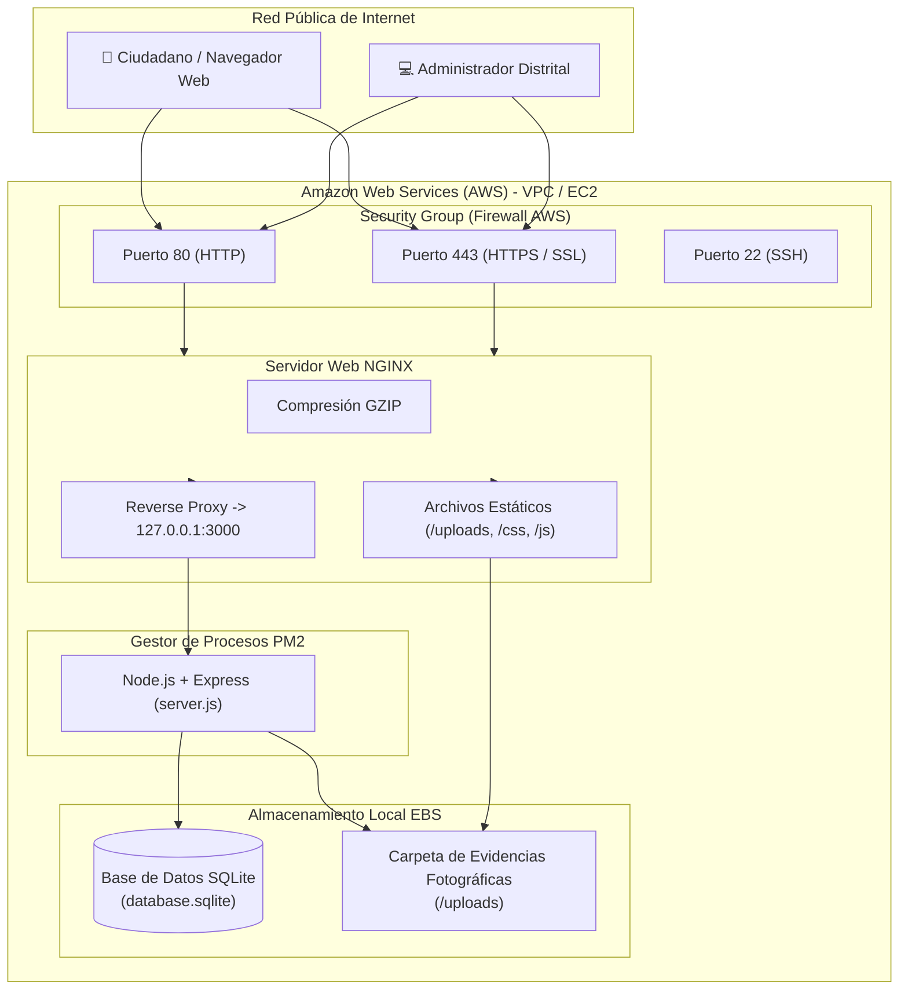

# ☁️ Guía Oficial de Despliegue en AWS (Amazon Web Services) con NGINX
## Santa Marta Reporta • Sistema Distrital de Incidencias Urbanas

Esta guía documenta paso a paso el procedimiento técnico para desplegar y alojar el sistema **Santa Marta Reporta** en una máquina virtual de **Amazon Web Services (AWS EC2)** con proxy inverso **NGINX**, gestor de procesos **PM2** y base de datos persistente.

---

## 🏛️ Arquitectura de Producción



---

## 📋 Requisitos Previos

1. Cuenta activa en [Amazon Web Services (AWS Console)](https://aws.amazon.com/).
2. Cliente SSH instalado en tu computadora (Terminal de Windows, PowerShell, Git Bash o PuTTY).
3. Par de llaves SSH descargado (`.pem`) generado en AWS.

---

## 🚀 PASO 1: Lanzar la Instancia EC2 en AWS

1. Ingresa a la consola de AWS y ve a **EC2** -> **Instancias** -> **Lanzar instancias** (*Launch instances*).
2. **Nombre:** `Santa-Marta-Reporta-Production`.
3. **Imagen del Sistema Operativo (AMI):** 
   - Selecciona **Ubuntu** (Ubuntu Server 22.04 LTS o 24.04 LTS, arquitectura 64-bit x86).
4. **Tipo de Instancia:**
   - Selecciona `t2.micro` o `t3.micro` (Elegible para la **Capa Gratuita / Free Tier** de AWS, 1 vCPU, 1 GiB RAM).
5. **Par de Claves (Key Pair):**
   - Selecciona o crea un nuevo par de llaves (ej: `santa-marta-key.pem`). Guárdalo de forma segura en tu computadora.
6. **Configuración de Red / Grupo de Seguridad (*Security Group*):**
   Marca las casillas:
   - ✅ **Permitir tráfico SSH desde:** Tu IP (o `0.0.0.0/0`).
   - ✅ **Permitir tráfico HTTP de Internet (Puerto 80).**
   - ✅ **Permitir tráfico HTTPS de Internet (Puerto 443).**
7. **Almacenamiento:** 10 a 20 GiB gp3 (Estándar de la capa gratuita).
8. Haz clic en **Lanzar Instancia** (*Launch instance*).

---

## 🔐 PASO 2: Conectar a la Instancia por SSH

Abre PowerShell o tu terminal y ajusta los permisos de la llave `.pem` si estás en Linux/Mac:
```bash
chmod 400 santa-marta-key.pem
```

Conéctate utilizando la **Dirección IPv4 Pública** que le asignó AWS a tu instancia:
```bash
ssh -i "santa-marta-key.pem" ubuntu@<TU-IP-PUBLICA-AWS>
```

*(Ejemplo: `ssh -i santa-marta-key.pem ubuntu@54.210.123.45`)*.

---

## ⚡ PASO 3: Despliegue Automatizado en 1 Solo Paso

Una vez conectado dentro de la terminal de tu servidor Ubuntu en AWS, ejecuta el siguiente bloque de comandos:

```bash
# 1. Clonar el repositorio del proyecto
git clone https://github.com/FabianAndres052/Santa-Marta-Reporta..git santa-marta-reporta
cd santa-marta-reporta

# 2. Dar permisos de ejecución al script de despliegue
chmod +x scripts/deploy-aws-ec2.sh

# 3. Ejecutar el script automatizado de aprovisionamiento
./scripts/deploy-aws-ec2.sh
```

### ¿Qué realiza automáticamente este script?
1. Actualiza los repositorios de Ubuntu (`apt-get update`).
2. Instala dependencias del sistema: `nginx`, `git`, `sqlite3`, `curl`, `ufw`.
3. Instala el entorno de ejecución **Node.js 20 LTS**.
4. Instala el gestor de procesos de producción **PM2**.
5. Ubica el proyecto en `/var/www/santa-marta-reporta` e instala las dependencias npm de producción.
6. Copia y activa la configuración optimizada de **NGINX** en `/etc/nginx/sites-available/santa-marta-reporta`.
7. Habilita compresión GZIP, cabeceras de seguridad y caché para activos estáticos.
8. Configura el firewall **UFW** permitiendo tráfico en puertos 80, 443 y SSH 22.
9. Arranca la aplicación con PM2 (`ecosystem.config.js`) y configura el arranque automático si el servidor se reinicia (`pm2 startup`).

---

## 🌐 PASO 4: Acceso y Verificación del Sistema

Abre tu navegador web y visita:

- **Portal Ciudadano:** `http://<TU-IP-PUBLICA-AWS>/`
- **Portal de Administración Distrital:** `http://<TU-IP-PUBLICA-AWS>/admin`

### Credenciales Administrativas:
- **Usuario:** `admin`
- **Contraseña:** `santamarta2026`

---

## 🔒 PASO 5: Configurar Dominio y Certificado SSL (HTTPS Gratuito con Certbot)

Si cuentas con un dominio o subdominio (ej: `reporta.santamarta.gov.co` o `reporta.tudominio.com`):

1. En tu proveedor DNS, crea un registro tipo **A** apuntando al IP público de tu servidor AWS.
2. Edita la configuración de NGINX:
   ```bash
   sudo nano /etc/nginx/sites-available/santa-marta-reporta
   ```
   Cambia la línea:
   ```nginx
   server_name reporta.tudominio.com;
   ```
3. Guarda los cambios (`Ctrl + O`, `Enter`, `Ctrl + X`) y recarga Nginx:
   ```bash
   sudo nginx -t && sudo systemctl reload nginx
   ```
4. Instala y ejecuta **Certbot** para obtener el certificado SSL gratuito de Let's Encrypt:
   ```bash
   sudo apt-get install -y certbot python3-certbot-nginx
   sudo certbot --nginx -d reporta.tudominio.com
   ```
5. ¡Listo! NGINX redirigirá automáticamente todo el tráfico HTTP a **HTTPS seguro**.

---

## 🛠️ Comandos Útiles de Administración y Mantenimiento

### Gestión del Proceso con PM2:
```bash
# Ver estado del proceso en tiempo real
pm2 status

# Monitorear consumo de memoria y CPU
pm2 monit

# Ver logs en vivo (errores y peticiones)
pm2 logs santa-marta-reporta

# Reiniciar la aplicación
pm2 restart santa-marta-reporta

# Detener o iniciar la aplicación
pm2 stop santa-marta-reporta
pm2 start santa-marta-reporta
```

### Gestión de NGINX:
```bash
# Probar sintaxis de la configuración
sudo nginx -t

# Recargar NGINX sin desconectar usuarios
sudo systemctl reload nginx

# Ver logs de acceso de NGINX
sudo tail -f /var/log/nginx/access.log

# Ver logs de error de NGINX
sudo tail -f /var/log/nginx/error.log
```

### Respaldo de Base de Datos y Fotos:
```bash
# Respaldar la base de datos SQLite
sqlite3 /var/www/santa-marta-reporta/database.sqlite ".backup '/home/ubuntu/backup_$(date +%Y%m%d).sqlite'"

# Comprimir respaldos de fotos y base de datos
tar -czvf /home/ubuntu/backup_completo_$(date +%Y%m%d).tar.gz \
    /var/www/santa-marta-reporta/database.sqlite \
    /var/www/santa-marta-reporta/uploads/
```

---

## 🛡️ Solución de Incidencias Frecuentes

1. **No carga la página tras lanzar la instancia:**
   - Verifica en la consola de AWS -> *Security Groups* que las reglas de entrada (*Inbound Rules*) permitan los puertos **80 (HTTP)** y **443 (HTTPS)** desde `0.0.0.0/0`.
2. **Error 502 Bad Gateway en Nginx:**
   - Significa que Node.js no está corriendo en el puerto 3000. Ejecuta `pm2 status` y `pm2 logs` para diagnosticar el servicio.
3. **Imágenes fotográficas no se cargan:**
   - Verifica los permisos del directorio de uploads: `sudo chmod -R 775 /var/www/santa-marta-reporta/uploads`.

